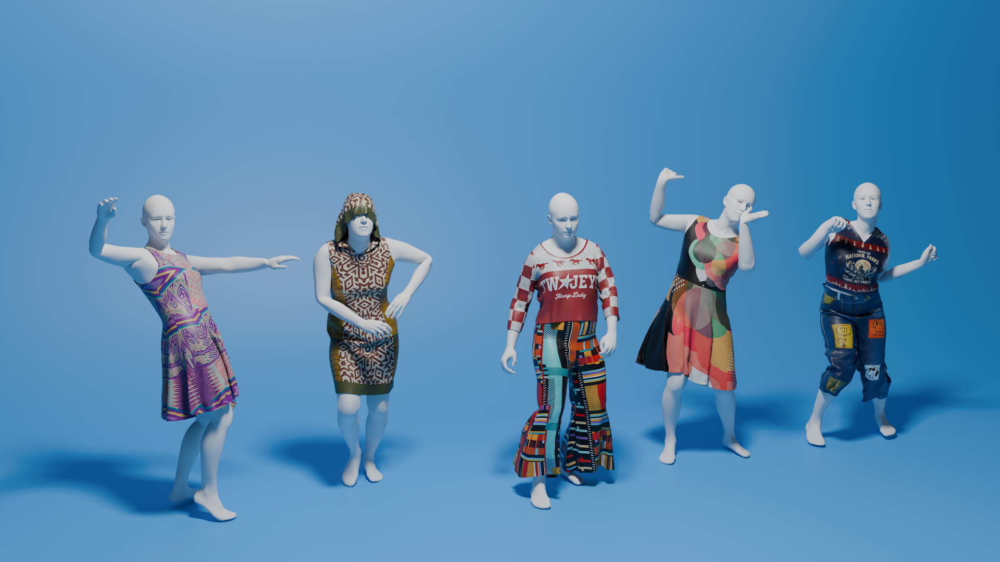

# OmniFabric: Coherent UV Space Texture Synthesis for 3D Garment Reconstruction

### SIGGRAPH Asia 2026

[Ding-Jiun Huang](https://willydjhuang.github.io/)<sup>1</sup>&nbsp;&nbsp;
[Yuanhao Wang](https://harrywang355.github.io/)<sup>2</sup>&nbsp;&nbsp;
[Cheng Zhang](https://czhang0528.github.io/)<sup>3</sup>&nbsp;&nbsp;
[Hugo Bertiche](https://hbertiche.github.io/)<sup>4</sup>&nbsp;&nbsp;
[Alexandru-Eugen Ichim](https://alexandruichim.com/)<sup>4</sup>&nbsp;&nbsp;
[Thabo Beeler](https://thabobeeler.com/)<sup>4</sup>&nbsp;&nbsp;
[Fernando De la Torre](https://www.cs.cmu.edu/~ftorre/)<sup>1</sup>

<sup>1</sup>Carnegie Mellon University &nbsp;&nbsp;
<sup>2</sup>University of Washington &nbsp;&nbsp;
<sup>3</sup>Texas A&M University &nbsp;&nbsp;
<sup>4</sup>Google

[](https://arxiv.org/abs/2609.30234)
[](https://humansensinglab.github.io/OmniFabric/)



## Abstract

> Automated generation of production-ready 3D garment assets from a single image is a central challenge in digital content creation. While recent generative models have significantly advanced 3D geometry reconstruction, synthesizing high-quality textures remains a bottleneck. Existing methods often bake environmental illumination and shadows directly into the texture map, or they fail to maintain global structural coherence, making the resulting assets unusable for physical simulation and relighting. In this work, we introduce OmniFabric, a novel approach that synthesizes globally coherent texture maps directly within the 2D sewing pattern space. Given a single reference image, our pipeline utilizes an estimated 3D mesh and generative priors of powerful Vision-Language Models (VLM) to establish a complete but coarse texture initialization across the unwrapped sewing patterns. We then leverage a specialized diffusion transformer, trained via an automated synthetic data engine and conditioned on 3D positional features, to refine this initialization directly in the canonical UV domain. This effectively removes distortion and baked-in artifacts to extract a clean and normalized texture map that preserves the original garment design. Extensive experiments demonstrate that OmniFabric significantly outperforms state-of-the-art baselines with high-quality 3D garments.

## Overview of OmniFabric

Given a single in-the-wild garment image, OmniFabric predicts a sewing pattern, synthesizes a globally coherent,
normalized texture directly in the sewing-pattern UV space, and simulates the textured pattern into a 3D garment.

| Stage | Step | Code | Note |
|---|---|---|---|
| Sewing pattern prediction | 1. Sewing pattern prediction and simulation | `omnifabric/sewing/predict_pattern.py`, `simulate.py` | ChatGarment (CVPR 2025) is used in this step |
| | 2. Preparation of the UV template, 3D position map P<sub>pos</sub>, and renderings of the neutral-posed garment | `uv_template.py`, `position_map.py`, `textured_sim.py` | |
| Coarse texture map generation | 3. Pose-aware texture transfer onto the frontal render → R<sub>f</sub> | `omnifabric/coarse/texture_transfer.py` | Two options are provided in this step: Gemini (recommended) and FLUX.2 |
| | 4. Multi-view generation (front/back/left/right) and texture projection | `orbit_views.py`, `project_multiview.py` | While Veo 3 is used in the original pipeline, we use MiniMax-H3-360 in this repo as a more accessible replacement |
| | 5. Baking the projected texture into the sewing-pattern UV space → T′ | `extract_uv_texture.py` | |
| Texture normalization and refinement | 6. Normalizing T′ conditioned on R<sub>f</sub> and P<sub>pos</sub> → T | `omnifabric/normalize/square_layout.py`, `infer.py`, `dilate_uv_panels.py` | |

`scripts/run_pipeline.sh` runs all the steps above for one image. Please see the execution instructions below.

## Installation

Two environments are needed: `omnifabric` for the whole pipeline, and `comfyui` for the ComfyUI server that runs
MiniMax-H3 (it requires a newer PyTorch/CUDA than the rest of the pipeline). Tested on Ubuntu 22.04 with NVIDIA RTX A6000 (48 GB) GPUs.

```bash
git clone https://github.com/humansensinglab/OmniFabric.git && cd OmniFabric

# 1. main environment (builds Warp, Hunyuan3D-2's rasterizer and flash-attn; needs a CUDA 11.8 toolkit)
conda env create -f environment.yml
conda activate omnifabric
CUDA_HOME=/usr/local/cuda-11.8 bash install.sh    # --no-flash-attn to skip the flash-attn build

# 2. ComfyUI environment for multi-view generation
git clone https://github.com/comfyanonymous/ComfyUI.git third_party/ComfyUI
git -C third_party/ComfyUI checkout fd734e95    # the ComfyUI commit OmniFabric was tested with
conda create -n comfyui python=3.12 -y && conda activate comfyui
pip install torch torchvision torchaudio --index-url https://download.pytorch.org/whl/cu130
pip install -r third_party/ComfyUI/requirements.txt
```

See [docs/INSTALL.md](docs/INSTALL.md) for details.

## Checkpoints

```bash
conda activate omnifabric
bash scripts/download_checkpoints.sh
```

The script downloads the MiniMax-H3 models. Please download the OmniFabric LoRA and ChatGarment weights manually from
the Google Drive links below; the pipeline checks that all checkpoints are in place before it starts.

| Model | Where it goes | Source |
|---|---|---|
| OmniFabric LoRA | `checkpoints/omnifabric/default.safetensors` | [Google Drive](https://drive.google.com/file/d/1qMdaFTy8Mbh4yGcm41FE4iMOqUrGIp9k/view?usp=sharing) (manual download, see the script) |
| ChatGarment | `checkpoints/chatgarment/pytorch_model.bin` | [Google Drive](https://drive.google.com/drive/folders/17JVZ1HYgMMMxw_zWmDgiVQ_PkIN-Fznf?usp=sharing) (copy of the [ChatGarment](https://github.com/biansy000/ChatGarment) weights, with their licenses) |
| MiniMax-H3 FL2VA, text encoder, video VAE, 360° orbit LoRA | `third_party/ComfyUI/models/...` | [Comfy-Org/MiniMax-H3](https://huggingface.co/Comfy-Org/MiniMax-H3), [pablodawson/MiniMax-H3-360-Orbit-LoRA](https://huggingface.co/pablodawson/MiniMax-H3-360-Orbit-LoRA) |
| FLUX.1-dev, FLUX.2-dev, Hunyuan3D-2, LLaVA-1.5-7B, CLIP ViT-L/14-336, Real-ESRGAN | Hugging Face cache | downloaded automatically on first use |

FLUX.1-dev and FLUX.2-dev are gated: accept their licenses on Hugging Face and run `huggingface-cli login` first.
The automatically downloaded models take about 200 GB (FLUX.2-dev alone is about 110 GB). Point `HF_HOME` to a disk with
enough space; `FLUX1_CACHE_DIR` / `FLUX2_CACHE_DIR` can point to existing Hugging Face caches of the two FLUX models.

## Inference

```bash
# terminal 1: ComfyUI server (multi-view generation)
conda activate comfyui
GPU=0 bash scripts/start_comfyui.sh

# terminal 2: the pipeline
conda activate omnifabric
GPU=0 bash scripts/run_pipeline.sh examples/dress_1.png outputs/dress_1
```

ChatGarment may predict several garments for one photo (e.g. a T-shirt and jeans for a full-body photo). The script then
lists them, each with a preview render, and asks which ones to texture (Enter textures all of them):

```
ChatGarment predicted:
  [1] upper     T-shirt
      preview: outputs/.../valid_garment_upper/valid_garment_upper/valid_garment_upper_render_front.png
  [2] lower     skirt
      preview: outputs/.../valid_garment_lower/valid_garment_lower/valid_garment_lower_render_front.png
Which garments to texture? e.g. 'lower' or '2', several separated by spaces [all]:
```

`GARMENTS="lower"` (or `"upper lower"`, `"all"`) answers this in advance, e.g. for batch jobs; without a terminal, all
predicted garments are textured.

### Frontal View Re-posing: FLUX.2 or Gemini

Step 3 re-textures the grey frontal garment rendering from the input image. We recommend using Gemini (Nano Banana) for
better quality, since this frontal view guides the side and back views generated next; FLUX.2-dev is the open-weight
alternative that runs automatically. When run from a terminal, the script asks:

```
How should the garment's frontal texture be generated?
    [1] Gemini (Nano Banana): manual, you generate the image in the Gemini app (as in the paper)
    [2] FLUX.2-dev: automatic, runs locally
  Choice:
```

With Gemini, the script prepares a hand-off folder `outputs/<name>/<garment>/gemini/`:

```
gemini/
├── 1_grey_garment.png   # grey garment-only frontal render on a green background: upload first
├── 2_reference.png      # the input photo: upload second
├── PROMPT.txt           # the prompt to send with them
├── README.txt           # these instructions
└── result/              # put Gemini's generated image here (any file name, .png/.jpg/.webp)
```

The prompt is: *"The grey apparel is my target apparel. Please generate textures on this grey apparel, so the textures
are 100% identical to the apparel in the reference image. Please don't change the style, size and pose of the grey
garment."* After saving the image, choose:

- `[c] Continue` (or Enter): imports the newest image in `result/`. If there is no image yet, the script shows the
  Gemini steps again and asks again; if the image cannot be read, it says so.
- `[f] Use FLUX.2 instead`: e.g. if Gemini's result is not good enough.
- `[q] Quit for now`: re-run the same command later; the sewing pattern and simulation are reused, and the image in
  `result/` is picked up.

### Output Folder Structure

Outputs for each predicted garment (e.g. `valid_garment_upper`, `valid_garment_lower` or `valid_garment_wholebody`):

```
outputs/dress_1/<garment>/
├── coarse_texture.png          # coarse texture map T′ (sewing-pattern UV space)
├── normalized_texture.png      # normalized texture T (final result, full resolution)
├── frontal_rendering.png       # textured frontal rendering R_f
├── <garment>_position_map.pt   # 3D position map P_pos
├── views/                      # textured frontal view (front_garment.png), orbit video and views
├── gemini/                     # Gemini hand-off folder (only with the Gemini option)
├── projection/                 # projection inputs and the textured mesh (.glb) with 6-view renders
├── normalize/                  # normalization inputs (inputs/part*/, rearranged if elongated) and outputs (part*/)
└── final/                      # simulated garment (<garment>/<garment>_sim.obj, renders) with T applied
```

## License

The OmniFabric code is released under the Apache 2.0 license. The pipeline depends on third-party models and code with
their own licenses, several of them non-commercial and/or with territorial restrictions — in particular the
[FLUX.1-dev](https://huggingface.co/black-forest-labs/FLUX.1-dev/blob/main/LICENSE.md) and
[FLUX.2-dev](https://huggingface.co/black-forest-labs/FLUX.2-dev) non-commercial licenses, the
[Tencent Hunyuan 3D community license](https://github.com/Tencent-Hunyuan/Hunyuan3D-2/blob/main/LICENSE), and the
[MiniMax-H3 community license](https://huggingface.co/MiniMaxAI/MiniMax-H3/blob/main/LICENSE), which does not grant
use in the EU, the UK, South Korea, or the USA. Check that your use complies with each of them;
`VIEWS_BACKEND=flux2` avoids MiniMax-H3 entirely.

The ChatGarment weights contain the Llama 2 backbone: Llama 2 is licensed under the LLAMA 2 Community License,
Copyright (c) Meta Platforms, Inc. All Rights Reserved, and its use is subject to the
[Acceptable Use Policy](https://ai.meta.com/llama/use-policy).

## Citation

```bibtex
@misc{huang2026omnifabriccoherentuvspace,
      title={OmniFabric: Coherent UV Space Texture Synthesis for 3D Garment Reconstruction},
      author={Ding-Jiun Huang and Yuanhao Wang and Cheng Zhang and Hugo Bertiche and Alexandru-Eugen Ichim and Thabo Beeler and Fernando De la Torre},
      year={2026},
      eprint={2609.30234},
      archivePrefix={arXiv},
      primaryClass={cs.CV},
      url={https://arxiv.org/abs/2609.30234},
}
```

We build on [ChatGarment](https://github.com/biansy000/ChatGarment), [GarmentCode](https://github.com/maria-korosteleva/GarmentCode),
[OminiControl](https://github.com/Yuanshi9815/OminiControl), [Hunyuan3D-2](https://github.com/Tencent-Hunyuan/Hunyuan3D-2),
[FLUX](https://github.com/black-forest-labs/flux2), [MiniMax-H3](https://huggingface.co/MiniMaxAI/MiniMax-H3) and the
[360° orbit LoRA](https://huggingface.co/pablodawson/MiniMax-H3-360-Orbit-LoRA).
